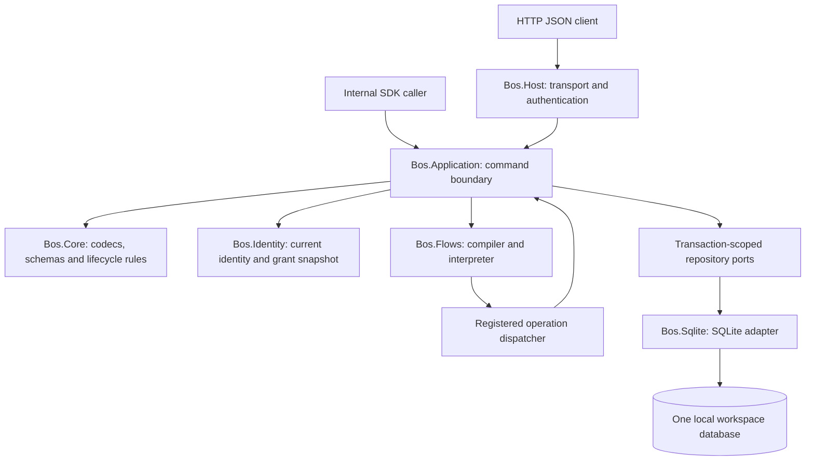

# Architecture and invariants

**Authority:** [Specification 1.0.0](specification-1.0.0.md), especially Sections 02–16, 27–29 and 33–38.\
**Status:** implementation design baseline; no runtime or adapter conformance evidence yet.

## 1. System boundary

BOS Core is one process, one workspace and one local SQLite database. It provides a headless HTTP API and matching internal application methods. Trusted startup code registers adapters and business operations. Administrators publish data definitions and restricted flow definitions; callers execute with their own permissions.



The interpreter calls application operations through the dispatcher. It never obtains a repository, database connection, CLR entity or unrestricted host capability.

## 2. Module ownership

| Module | Owns | Important dependency boundary |
| --- | --- | --- |
| `Bos.Contracts` | Stable DTOs, immutable typed values, errors, descriptors, execution context and ports | Shared contract definitions; no host-specific persistence implementation. |
| `Bos.Core` | Codecs, canonicalization, schema validation/evolution, lifecycle validation, guard rules and expression rules | Rules must be usable independently of HTTP and SQLite. |
| `Bos.Application` | Method handlers, authorization decisions, operation dispatch, transaction ownership, receipt/replay orchestration | All business entry points converge here. |
| `Bos.Sqlite` | Transactions, repositories, migrations, constraints, typed indexes, query compilation and interruption | Repositories do not authorize on their own as a replacement for application checks and never commit independently. |
| `Bos.Identity` | Identity adapters, user/role primitives, live grants, cookie and opaque-token integration | Identity writes share the root transaction with BOS audit/grants/receipts. |
| `Bos.Flows` | Restricted YAML parsing, compilation, pinned AST, pure helpers and bounded interpretation | No reflection, external I/O, flow-to-flow invocation or mutable business objects. |
| `Bos.Host` | HTTP mapping, authentication/antiforgery plumbing, CLI, configuration, admission, health and dependency registration | Composition root selects only registered implementations. |
| `Bos.Conformance` | Shared contract and adapter tests, actual HTTP/application tests, fault/race/crash fixtures | Integrated gates use real persistence and authorization. |

The reference Material Request operations belong to an explicitly registered application module. Their final project placement is an implementation decision; their contract is fixed by specification Section 38.

## 3. Shared contract freeze

Agent 1 owns the shared contract freeze before parallel module implementation. The specification defines behavior and DTO shapes; C# signatures and transaction-enlistment details still need to be agreed and implemented.

### Values and schemas

- Closed value kinds: String, Boolean, Integer, Decimal, Date, Instant, Null, Missing, Array and Object.
- Business integers use canonical JSON strings; metadata revisions/versions use positive Int32 JSON numbers.
- Missing is internal absence, never serialized as null or a normal output value.
- Objects and arrays exposed to flows are immutable values.
- Decimal arithmetic uses exact intermediates and explicit named rounding when precision is discarded.
- Record schemas and flow/operation schemas share value grammar; persistence-only properties are forbidden in flow/operation data schemas.

### Invocation context

```text
ExecutionContext = {
  principalId, credentialId, commandId, runId?, startedAt,
  effectiveGrants, guardOwner?, budget
}
```

The context is server-created. Nested dispatch preserves root identity, correlation, transaction, cancellation and shared budgets. The dispatcher alone changes the nearest business-operation `guardOwner`. A method argument can never replace those values.

The flow-visible `ctx` contains only `principalId`, `runId`, `startedAt` and `workspaceTimezone`.

### Ports

Freeze the specification's unit-of-work, definition, record, identity, run, receipt, audit, registry, compiler, executor, clock, ID and backup ports. Specify asynchronous signatures, cancellation propagation, immutable return values and error mapping in the C# contract. Repository results are bounded and materialized within the owning unit of work.

### Method registry

One registered catalogue drives HTTP dispatch, internal invocation, operation discovery, capability reporting and OpenAPI. Each method must have declared arguments/results, version, transport, mode, grant requirements and flow-callability as applicable. Only implemented callable methods appear in enabled capabilities. Reserved names return `FEATURE_NOT_AVAILABLE` and remain disabled.

## 4. Transaction owner and write path

The **root application invocation** owns the transaction. For flows, this is the application run orchestrator. Repositories, Identity stores, interpreter steps and nested operations enlist; they cannot commit or open independent writable transactions.

### Standalone write

1. Enforce transport byte/depth limits and strict decoding, including duplicate-key rejection.
2. Authenticate; validate declared arguments and the required idempotency key.
3. Apply admission/storage checks before admitting work.
4. Begin a write unit of work using `BEGIN IMMEDIATE` within the lock-admission deadline.
5. Reload principal activity, credential validity/scopes and effective grants in that transaction.
6. Authorize the method/resource and any replay disclosure.
7. Resolve an existing receipt or compute the canonical request hash before defaults. A successful replay does not execute business work again.
8. Resolve the permitted schema version and enforce operation/field write guards.
9. Merge/default, normalize and validate; check live/readable references and uniqueness.
10. Persist record state, references, indexes, every history revision, audit and the successful receipt in the same transaction.
11. Commit once; return success only after the committed outcome is known.

A failed direct command leaves neither business changes nor a successful command receipt. `NO_CHANGE` creates no record revision or mutation audit. Secret-setting receipts follow Section 37's exceptions.

### Atomic command flow

```mermaid
sequenceDiagram
    participant C as Caller
    participant A as Application run orchestrator
    participant D as SQLite
    participant F as Bounded interpreter / dispatcher
    C->>A: flows.run(name, exact version, input, key)
    A->>A: Decode, authenticate, authorize and admit
    A->>D: Short transaction: durable running reservation + hash
    D-->>A: Reservation committed
    A->>D: BEGIN IMMEDIATE
    A->>D: Reload activity, scopes, grants and flow control
    A->>A: Resolve pinned dependencies; capture execution time/deadline
    A->>F: Execute validated persisted AST in same UoW
    F->>D: Application-authorized reads and staged writes
    alt Output and all steps valid
        A->>D: Write business history/audit + succeeded receipt
        A->>D: COMMIT once
        A-->>C: Succeeded RunReceipt
    else Failure before commit
        A->>D: ROLLBACK all business effects
        A->>D: Separate short transaction: failed receipt + sanitized error
        A-->>C: Failed RunReceipt for accepted execution
    end
```

If terminal-failure persistence fails, the durable reservation remains running and is recoverable as interrupted. If commit outcome is uncertain, use a fresh connection to resolve the stored receipt/run before classifying the outcome. A lost HTTP response is not proof of rollback.

### Query flow and standalone reads

- Standalone reads reload live authorization and use a bounded committed snapshot.
- A query flow uses one read snapshot; no write operation is permitted.
- Query-flow results are persisted after its read snapshot closes. A crash before receipt persistence leaves an interrupted outcome.
- A read nested in a command flow uses its write transaction and sees staged writes.

## 5. Durable-state invariants

| ID | Invariant | Primary proof |
| --- | --- | --- |
| I01 | A record references one immutable published `(type, version)` and validates against that version. Publication never rewrites old records. | A02, A03, A17 |
| I02 | Record state, references, unique/index entries, every history revision, mutation audit and success receipt agree atomically. | A05, A08, A12, A14, A20 |
| I03 | Only the root invocation commits. Any failed nested operation poisons the enclosing transaction, including caught host exceptions. | A05, A12, A24 |
| I04 | Business decisions execute after acquiring the write reservation; stale user intent still fails its explicit expected revision. | A06, A07, A23 |
| I05 | Effective access is current principal grants intersected with credential scopes and all applicable flow/operation capability ceilings. No privilege elevation occurs. | A04, A13, A16 |
| I06 | `guardOwner` is the nearest registered business operation; generic record methods preserve it and clients cannot supply it. | A04, A23 |
| I07 | Every actual mutation increments revision, including repeated mutations in one flow; no-op updates do not. Create-then-delete in a run fails. | A05, A06, A23 |
| I08 | Live references, including nested ones, prevent target deletion; tombstones preserve data/history and release live reservations. | A08 |
| I09 | Queries/cursors use the same canonical typed comparisons as validation and uniqueness; no partial count masquerades as exact. | A02, A09, A10 |
| I10 | Published flow execution uses the persisted validated AST, its format/hash and exact dependencies, never editable source or a substituted operation version. | A03, A17 |
| I11 | An accepted command flow has a durable reservation; success is atomic with business effects; startup interrupts abandoned runs without replaying them. | A13–A15, A20 |
| I12 | One shared invocation budget covers nested calls, expressions, items and loops; cancellation reaches both trusted operations and SQLite. | A11, A18 |
| I13 | Secrets never enter flow context, receipt hashes/payloads, business logs or normal discovery. Token plaintext is disclosed once. | A13, A19, A24 |
| I14 | Identity/grants/audit/receipts share transaction ownership, and the last active administrator cannot be removed by any administrative path. | A16, A24 |
| I15 | One OS workspace lock protects serve, recovery, initialization, backup, restore and offline account recovery from competing owners. | A14, A15, A21 |

## 6. Storage design obligations

The fixed relational schema stores definitions, records, indexes, references, Identity, runs, receipts and audit as described in specification Section 16. Adding a record type adds definition data, not a relational table.

- Configure every connection with foreign keys enabled and dirty reads disabled. Use WAL, `synchronous=FULL` and a 1-second busy timeout.
- Use composite record-to-type/version foreign keys and unique receipt/value constraints.
- Maintain indexed reverse references for RESTRICT deletion and typed scalar index entries for filtering/ordering.
- Keep Missing, Null and Present distinct in index ordering. Compare integers/decimals numerically and strings ordinally.
- Compile only declared query fields/operators; parameterize caller values.
- Install a progress callback every 1,000 VM instructions and interrupt by 1,000 callbacks or the query/run deadline. Do not replace this with a row estimate.
- Keep migrations transactional and refuse unsupported newer engine schemas.

## 7. Authorization and credential boundaries

### Identity and sessions

Use ASP.NET Core Identity managers and hashing/lockout primitives with a SQLite-backed store. A human session is an HTTPS-only, HttpOnly, SameSite=Lax cookie with a fixed eight-hour lifetime. State-changing cookie requests, including login, validate antiforgery tokens.

Session claims are identifiers, not an authoritative grant cache. Principal disablement and stamp invalidation must be enforced at the specification's transaction/request boundary; a default framework validation interval must not accidentally weaken that behavior.

### Opaque API tokens

Token authentication verifies lookup ID, active service principal, expiry, revocation and a constant-time comparison against the stored SHA-256 secret hash. Current principal grants still bound stored token scopes. Token issuance checks both target-principal grants and issuer authority.

### Disclosure

- Unreadable, missing and deleted records return `NOT_FOUND` from `records.get`.
- Unreadable queries fail `FORBIDDEN`.
- Reference errors do not distinguish inaccessible targets from nonexistent ones.
- Run ownership/readAll access gates metadata. Current flow execution and all touched-type read grants additionally gate result/step data.
- Replay reauthorizes before returning saved data; an idempotency key is not an access capability.

## 8. Flow safety and resource ownership

The parser rejects prohibited YAML events before expanding or constructing a general object graph. Compilation creates closed versioned instructions and expressions with lexical scopes, unique step IDs, explicit dependencies and all-path return checks.

The interpreter supports only `let`, `call`, `if`, `forEach`, `require`, `log` and `return`. Pure helpers never query storage. A string remains text, including `${...}` or source code. Short-circuiting helpers evaluate left to right; missing values cannot leak into normal helpers or output serialization.

Enforce the exact ceilings in specification Section 27, including shared item/expression budgets, SDK calls, mutation and return counts, output/diagnostics sizes, operation depth and the two-second execution deadline. Configuration may lower these ceilings. Rate/admission limits and database interruption complement cooperative cancellation; they are not an OS-level sandbox guarantee.

## 9. Material Request invariant

```text
CreateRequest -> Draft
Draft --ReviseRequest--> Draft (contentVersion and parent revision advance)
Draft --RepriceRequestLine + FinalizeRequest--> Submitted
Submitted --ApproveRequest--> Approved
```

Only allowed operations may mutate the two operation-only types. Revise checks Draft, parent/line revisions and line ownership, resets affected amounts/total and increments parent contentVersion once. Finalize independently recomputes amounts, checks the complete bounded line set, sums exactly and checks the original parent revision. Direct calls must preserve the same invariants as the reference YAML orchestration.

The reference two-line fixture must yield `300.00`, `600.00` and `900.00`. A later failure, overflow or stale parent revision rolls back earlier pricing writes and their history/index effects.

## 10. Operator lifecycle

Serve acquires the workspace lock before opening/recovering storage and interrupting abandoned runs. Offline initialization, backup, restore and reset require that same exclusive ownership.

Backup uses the database backup API, hashes all bundled entries and verifies a temporary snapshot before atomic rename. Restore verifies entries/integrity/version into an empty target, invalidates restored sessions/tokens, regenerates cursor secrets, marks abandoned runs interrupted and issues a local recovery secret. Preserve committed receipts and replay keys from the snapshot.

Shutdown stops admission, drains bounded work for up to ten seconds, then cancels remaining work. A committed success stays authoritative even if the client disconnects or the process stops before transmitting its response.
